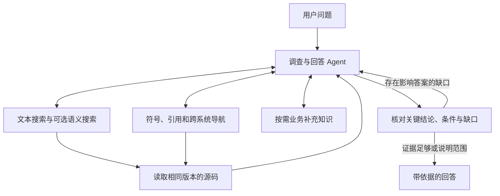

# 代码问答公开方案调研与改造建议

调研日期：2026-10-28。

2026-10-29 补充：进一步展开知识检索的完整链路，以及区分检索设计、模型能力和调查预算的验证方法。

2026-10-29 执行进度：用户随后确认实施，第一阶段的独立检索诊断与固定证据接口已落地，见[首轮执行记录](retrieval-diagnosis-20261029.md)。后文“本轮只提出方案”等描述保留为调研当时的范围；现行实现与操作以 `docs/spec/retrieval-evaluation.md` 为准。

用户反馈的主要问题是：答错或漏掉关键业务、调用关系。本文结合当前源码、历史问答记录、公开产品文档和论文提出候选方案；它不是已经采用的新规范，也不表示改造收益已验证。当前规范仍以 `docs/spec/knowledge-backbone-direction.md` 第 11 节为准。

## 1. 建议与判断依据

建议保留成熟 Coding Agent 作为调查和回答主体，增加可按需调用的代码搜索、符号引用和跨系统导航能力，同时对复杂问题增加有源码依据的结论核对。业务补充知识继续解释源码不能可靠表达的项目语义。

优先解决三件事：找到必要证据、补齐影响结论的关系、避免从局部事实推出过强结论。继续扩写大块知识主干，不能分别解决这三类问题。

当前架构“由 Agent 自主调查”的方向合理；不足在于可用工具与质量诊断仍偏薄。也不能先认定检索是唯一瓶颈：如果模型拿到必要源码后仍然推错，就需要调整模型、推理条件或复核方式。

## 2. 当前实现中可以确认的事实

| 事实 | 依据 | 对改造的含义 |
| --- | --- | --- |
| 主问答默认提供 `Read / Glob / Grep`，没有显式接入本项目的符号和调用查询工具 | [claude_runtime.py](/Users/dongyangwei/Documents/学习/代码对话2/business_code_agent/query/claude_runtime.py:40) | 复杂关系主要靠模型搜索文本后自行拼接；可以补工具，不必重写整个 Agent |
| 已有符号搜索、引用查找、本地调用和跨应用导航方法 | [evidence.py](/Users/dongyangwei/Documents/学习/代码对话2/business_code_agent/codeintel/evidence.py:170) | 有可复用基础，但不能直接把现有结果作为完整、精确调用图 |
| Java 索引器明确不解析 Java 类型；引用查询包含名称匹配，本地调用按应用内目标名唯一来连接 | [analysis.py](/Users/dongyangwei/Documents/学习/代码对话2/business_code_agent/codeintel/analysis.py:31)、[evidence.py](/Users/dongyangwei/Documents/学习/代码对话2/business_code_agent/codeintel/evidence.py:298) | 同名方法、接口实现和运行时绑定需要更准确的来源；原有 `VERIFIED` 不能直接解释为编译器确认 |
| 跨应用连接器主要依据 HTTP/Feign 两端事实、方法、路径和服务名匹配 | [edges.py](/Users/dongyangwei/Documents/学习/代码对话2/business_code_agent/knowledge/edges.py:11) | 可以提供候选导航，但不能证明消息消费、回调时序和业务因果关系全部覆盖 |
| 正式问答提供无主干、有主干、AST 三种模式；组合资料已用于评测配置 | [service.py](/Users/dongyangwei/Documents/学习/代码对话2/business_code_agent/query/service.py:26)、[workspace.py](/Users/dongyangwei/Documents/学习/代码对话2/business_code_agent/query/workspace.py:24) | 新工具与组合资料应先以实验配置验证；不直接把实验分组改成产品默认策略 |
| 当前提示已经要求核查条件、结果和跨仓库线索，并要求总结不能强于证据 | [workspace.py](/Users/dongyangwei/Documents/学习/代码对话2/business_code_agent/query/workspace.py:541) | 不能继续把问题简单归因于“缺少一句提示”；要观察这些要求是否在实际答案中落实 |
| 普通源码和业务资料变化没有进入会话重用的版本判断，当前判断包括范围、模式和 AST 版本 | [service.py](/Users/dongyangwei/Documents/学习/代码对话2/business_code_agent/query/service.py:151) | 新检索结果、源文件和续聊必须使用一致的资料版本，否则增加工具也可能混用新旧依据 |

以上是源码事实。它们解释了可能的薄弱点，但没有证明每个用户错题都由这些因素导致。

### 一条历史答案揭示的另一类问题

在 `abcde-formal-20260909` 的 `v2-stale-failed`、`code_map` 答案中，模型已经找到付款结果处理、入账和额度释放的代码，却把终态检查、入账前查询和数值归零共同描述为“挡住竞态”的机制，并继续声称即使两个事务都通过了检查，也有兜底防重。

冻结源码中，`releasePreOccupied` 在扣减并把预占下限设为零后，仍继续调用 `record` 写释放流水。因此，“预占不会变成负数”本身不能证明“重复执行没有副作用”。`book` 的先查询、后调用也不能仅凭这两个动作证明所有并发调用都不会重复提交。

依据：[冻结的额度释放实现](/Users/dongyangwei/Documents/学习/代码对话2/validation-projects/complex-loan/.data/evaluations/abcde-formal-20260909/inputs/repo-3/src/main/java/com/rsd/middle/credit/LimitService.java:163)、[冻结的入账实现](/Users/dongyangwei/Documents/学习/代码对话2/validation-projects/complex-loan/.data/evaluations/abcde-formal-20260909/inputs/repo-3/src/main/java/com/rsd/middle/drawdown/DrawdownService.java:218)。

这里确认的是原答案包含超出引用代码支持范围的推断，没有执行并发测试，也不据此断言线上一定发生重复处理。这个历史批次早于后续提示词修订，不能作为最新提示仍然失败的复测结果。

该条旧模型评审还把事务边界作为支持强保证的依据。后续复核必须同时审查答案和评分依据，不能靠多加一个模型评分就假定质量问题解决了。

## 3. 公开方案提供了哪些可借鉴的设计

下表的“借鉴判断”是本项目建议，不是产品厂商对本项目的效果承诺。

| 方案 | 公开资料可确认的设计 | 借鉴判断与限制 |
| --- | --- | --- |
| Cursor | Agent 同时使用语义搜索和 grep；官方发布过同模型有无语义搜索的对照。[官方研究](https://cursor.com/blog/semsearch) | 自然语言业务描述可能找不到同名代码，语义召回值得试验；精确标识符仍交给文本搜索。厂商内部数据不能直接外推到本项目 |
| Sourcegraph / Cody | 上下文来自关键词、代码搜索和结构关系；精确导航使用语言索引，无精确索引时回退到搜索。[上下文文档](https://sourcegraph.com/docs/cody/core-concepts/context)、[精确导航](https://sourcegraph.com/docs/code-navigation/precise-code-navigation) | 将“搜到同名文本”和“找到符号引用”分开；先解决定义、引用、实现定位。编译期关系仍不等于完整运行时业务链 |
| Serena | 通过语言服务器或 IDE 后端向 Agent 提供符号、引用、实现等查询；不同后端和语言的能力不同。[官方仓库](https://github.com/oraios/serena) | 可用来验证给 Agent 增加少量符号工具是否有效。先验证项目所用语言与构建环境，不能因工具名包含语义就视为自然语言向量搜索 |
| Aider repo map | 用简洁的文件、类、函数和签名地图帮助定位需要进一步读取的代码。[官方文档](https://aider.chat/docs/repomap.html) | 支持继续保留轻量代码导航；不能据此把整个业务流程重新写成每轮注入的大文档 |
| DeepWiki / Ask Devin | 生成架构说明、文档与源码链接，并结合代码搜索回答问题。[Wiki 文档](https://docs.devin.ai/work-with-devin/deepwiki)、[问答文档](https://docs.devin.ai/work-with-devin/ask-devin) | 自动说明适合项目入门和导航；实现判断仍须回源码。公开文档说明了产品能力，没有公开足以完整复制其内部检索与排序系统的细节 |
| RANGER | 提出代码结构图、实体查询、自然语言查询与图探索相结合的检索方案。[论文](https://arxiv.org/abs/2509.25257) | 说明结构关系可以参与检索；其包含定位、依赖检索和补全等任务，不能把所有成绩等同于业务问答质量。完整图与复杂搜索算法不是第一阶段必需品 |

研究结果也没有支持某一种架构普遍最优：

- SWE-QA 比较了检索和 Agent 方法，展示了仓库级、多文件推理仍有明显困难；其公开题目与本项目中文跨系统业务问题存在差异。应借鉴题型和评测方法，不照搬排行榜结论。[论文正文](https://arxiv.org/html/2509.14635v2)
- 2026 年 8 月的一项预印本发现，在其选定模型、工具和评测条件下，语义检索优于分层委派搜索，并分析了交接造成的错误。它不是对所有多 Agent 系统的证明，能支持的工程判断是：增加 Agent 数量必须单独验证。[研究](https://arxiv.org/html/2608.01507v1)
- StackRepoQA 研究了 Java 仓库问答中的结构增强，也指出检索噪声及公开答案记忆会影响评价。这支持使用本项目真实错题和独立保留题验证，而不是只看公开仓库演示。[研究](https://arxiv.org/html/2603.26567v1)

这些来源共同支持的是：把适当证据提供给模型、让模型继续调查并检查结论。它们不足以证明“上向量库”“上图谱”或“多 Agent”任何一项单独就能解决当前问题。

## 4. 推荐的目标设计

一个负责回答的 Agent，按问题需要调用代码工具和业务资料；对复杂问题维护一份简短的调查记录，回答前核对关键结论。Python 提供资料与工具、版本约束和运行记录，不恢复按固定业务规则编排所有问题的旧 Agent。

箭头表示能力之间的关系，不要求简单问题遍历全部步骤。

### 4.0 将知识检索定义为可独立验证的能力

只增加搜索工具仍不构成完整检索设计。现有实现较完整地处理了目录、资料模式、工作区和调查事件，但主问答的召回、排序、上下文组织与继续检索主要由 Agent 自行完成。因而目前更容易看到最终回答好坏，较难解释资料究竟在哪里帮助了调查，或在哪个环节失效。

建议以如下链路组织设计；前两项是资料准备，其余由模型按问题需要调用，并非每个问题都强制执行所有环节：

| 环节 | 具体设计和产物 | 如何验收 |
| --- | --- | --- |
| 资料准备与更新 | 源码、需求、业务语义、结构导航分别登记工程、适用范围、来源和版本；更新时同步索引与引用 | 搜到的条目对应当前选择的资料，失效位置可定位，不混用旧会话依据 |
| 检索单元 | 业务资料以可理解的章节或语义条目为单位；源码以符号、配置段和必要上下文为单位；结构关系保留两端位置 | 片段保留适用条件、例外和来源，不把标题命中视为找到答案 |
| 问题与检索表达 | 提取明确业务对象、系统、状态、标识符；结合有来源的项目别名补充检索表达 | 能处理业务说法与代码命名差异；不把模型猜测的术语绑定写成知识事实 |
| 多路召回 | 精确文本、业务资料语义、代码符号和结构关系按需要提供候选；先限定工程与本轮范围 | 必要业务语义和必要源码都能被找到；结构入口与行为证据分别计量 |
| 合并与排序 | 合并重复片段，结合相关性、适用范围和版本选择候选；关系题考虑互补端点，而非全部返回相似片段 | 在相同上下文预算下，提高必要证据覆盖，减少无关及重复内容 |
| 上下文组织 | 给出原文位置、来源类型、条件与证据角色；必要时补读相邻判断、调用端点和异常分支 | 有经验的读者能从交给模型的材料中回答问题，不需要用想象补齐前提 |
| 按缺口继续检索 | Agent 根据尚未核实的相关环节展开引用、跨系统或术语查询；记录本次新增证据 | 能补齐会改变结论的缺口；不把重复搜索或自报高置信当作充分性依据 |
| 反馈与回归 | 将失败落到资料缺失、召回遗漏、排序丢失、组织丢失、使用错误等原因，再更新对应环节 | 同类真实错题得到改善；原来答对的普通问题没有明显退化 |

不需要同时建设多个数据库或引入大量新组件。先用统一结果格式串起已有文件、索引和运行记录，再依据失败原因替换某个环节。

每次检索结果至少保留：所属工程与仓库、资料版本、来源类型、文件/章节/行号、原文片段、适用范围、候选由什么方式取得，以及是否只是导航。业务语义证据、实现证据与导航线索不能混成同一种“相关片段”。

例如询问“极优产品付款成功后为何仍显示处理中”，所需材料可能同时包括：极优对应的代码代号、付款和入账的业务边界、接口如何计算展示状态、失败后的补偿路径。仅召回许多含“成功”的片段，不能视为完成检索。

相关性和充分性也要分开：某片段与问题高度相关，可能只覆盖入口；只有补齐本题需要的条件、行为和结果，材料才足以支持回答。可以借鉴 [Sufficient Context](https://arxiv.org/abs/2411.06037) 对上下文充分性的区分，以及 [RAGChecker](https://github.com/amazon-science/RAGChecker) 对检索与生成分别诊断的做法；这些研究不是本项目业务代码题的直接验收结果，自动评价仍需人工抽查。

### 4.1 检索：精确搜索、语义搜索和结构导航各司其职

已有类名、方法名、状态值、错误文本时，保留精确搜索。只有业务说法与代码命名不一致、首次入口难找等情况，才需要语义召回补充候选。

语义索引按函数、类、配置段、SQL 或文档章节组织，保留所属文件、符号、签名和定位信息；不要统一按固定字符数切断函数。过长函数返回定位与相关段落，再按需扩读。

候选排序考虑问题相关性、明确标识符和已发现的结构关系，去除重复；不把同一文件的多个相近片段挤满上下文。具体返回条数与大小从错题实验调整，不预先规定所有问题都取同一个数量。

第一版可复用现有文本搜索与 SQLite 导航数据。自然语言召回若确有收益，再选择满足中文问题与目标代码语言的嵌入模型及存储方案；不要把部署向量数据库当成先决条件。

### 4.2 结构：提供可查的关系，不预写完整业务答案

先为最常用语言验证语言服务器或 SCIP 类索引的定义、引用和实现查询能力。已有解析结果继续作为候选线索，但在工具输出中说明依据来源和解析能力。

建议第一批只读工具如下，名称为设计示意：

| 工具 | 返回内容 | 主要解决的问题 |
| --- | --- | --- |
| `search_code` | 精确或语义候选、路径、定位、命中原因 | 业务说法与代码名称不一致，入口难找 |
| `read_symbol` | 声明、签名、当前源码段及文件位置 | 只看到摘要，没读取实现 |
| `find_references` | 符号引用、调用位置及解析依据 | 漏掉调用方、误连同名方法 |
| `find_implementations` | 接口/抽象定义及可定位的实现 | 只看接口，没看实际逻辑 |
| `find_integration_links` | HTTP、RPC、消息、回调或任务的候选衔接与两端定位 | 在本仓库找到入口后漏查其他系统 |

调用关系只表达静态可确认的部分。动态路由、依赖注入、框架回调或消息匹配不够明确时，返回候选与缺少的绑定依据，交由 Agent 核查配置和源码。不要将名称唯一或路径相似直接升级为业务事实。

工具必须按 `ProjectContext`、本轮仓库范围和资料版本提供结果。返回项至少带仓库、文件位置、资料版本以及关系由何种方式获得。MCP 可作为接入方式，但它只是传输接口，不是提高问答质量的算法。

现有 AST 仍只能手动生成并引用版本。新的结构索引也应通过显式准备或更新操作提供；查询、切换页面和启动评测只读取已有资料。没有结构资料时使用现有文本能力，不暗中生成 AST。

### 4.3 业务：维护真正缺失的语义

保留现有短文档方向。重点补项目特有别名、系统职责、状态的业务含义、隐式跨系统约定和例外，注明来源与适用范围。

例如，“外部付款成功是否等于业务完成”属于可能需要补充的语义；“某方法在第几行调用另一个方法”由结构工具和源码解决。关联业务资料与实现时分别保留依据，避免用需求目标解释成当前已实现。

自动生成的模块说明若被验证有用，可作为可丢弃、可更新的导航缓存；不直接写入人工业务补充知识，也不承担最终实现证据。

### 4.4 调查：围绕用户的问题检查覆盖

复杂题的调查记录只记外部可核查的结论、证据和待查事项，不要求模型输出完整内部推理过程。

以“第一次成功回调后入账未完成，第二次回调会怎样”为例，记录项可以是：

| 要回答的部分 | 所需证据 |
| --- | --- |
| 两次请求进入哪个处理入口 | 回调入口及实际调用 |
| 第二次遇到什么状态和判断 | 相关状态字段、分支条件及更新位置 |
| 入账失败后的后续动作 | 异常路径、补偿入口及再次执行条件 |
| 台账是否可能再次变化 | 调用条件与实际写入逻辑；若讨论并发，补充对应协调机制 |

只调查会影响这道题结论的路径，不把每题扩展成全系统审计。关系图是帮助补线索的工具，完成判断仍取决于问题覆盖和源码依据。

### 4.5 核对：检查“依据是否支持结论”，不只检查引用是否存在

简单定位题由主 Agent 直接回答。跨系统、状态变迁或时序问题，在输出前核对用户明确询问的各部分，以及足以改变结论的已发现分支。

机械校验可以确认引用文件、行号和版本是否存在，但不能证明业务解释正确。语义核对要检查条件与结论的关系，例如数值下限不能单独证明幂等，顺序查询不能单独证明并发安全。

可以先让同一 Agent 按调查记录收尾；如果真实错题仍有过度推断，再做一次独立复核的对照。复核必须读取关键原文，指出具体矛盾或缺口，不靠“再检查一次”式自评分；也不默认启动多角色讨论。

对确实依赖运行时行为的问题，可在单独验证环境执行针对性的现有测试或最小实验，并把观测条件写入答案。这是后续可选能力，不要求所有问答开放执行权限。

### 4.6 输出：让用户看到有效信息

默认先回答问题，再给关键条件、必要的调用关系和贴近结论的源码链接。只有影响结论的未确认部分才单独说明。

用户无需理解内部的索引模式、检索步骤或证据对象。当前模式切换保留给对照实验和兼容入口；若新方案验证有效，再考虑产品默认按需使用已准备好的资料。避免要求用户先选“主干还是 AST”才能得到完整答案。

## 5. 先诊断，再选择投入方向

先整理约 20 道真实失败或不完整问题，同时保留一组原本答对的普通问题。覆盖入口定位、接口实现、跨仓库调用、状态/时序和业务术语；不要求平均凑齐类别。

将开发诊断题和独立验收题分开。对于诊断题，人工整理必要原始源码与业务资料，但不要在给模型的上下文里直接写参考答案。

| 对照 | 固定什么、改变什么 | 能回答的问题 |
| --- | --- | --- |
| 当前系统原样答题 | 固定源码、问题、模型、工具配置 | 现状基线是什么 |
| 同模型获得人工选出的必要原文 | 相同回答要求，主要改变证据获取 | 错误是否主要发生在找资料或证据选择阶段 |
| 另一个候选模型获得同一批原文 | 保持证据和评价标准一致，主要改变模型 | 已有证据下的解释能力是否成为瓶颈 |

这是诊断实验，不是生产方案收益实验；人工提供证据不代表系统已能自动找到它。如果不同模型都不能回答，继续检查题目条件、资料缺失或评价标准，而不是默认再堆检索层。

之后只对得到支持的改动做单变量对照：先加结构工具，或先加语义搜索，或先改复杂题核对；由错题原因决定顺序。最后再测组合。每轮使用同题、同源码和一致模型设置，生产与评测复用同一套工具配置。

评价至少分开记录：

- 必要证据有没有进入实际阅读上下文，而不只是出现在候选列表；
- 正确入口、关系端点及关系成立条件的覆盖；
- 有实质错误或遗漏的答案比例；
- 原来答错变对、原来答对变错的题目数；
- 无依据的确定性断言和不必要拒答，防止通过“全部说不确定”换取低错误率；
- 准备、答题、复核耗时与实际用量，包含索引和维护成本。

模型初评与人工复核分开。标准与源码冲突时，修订并独立重评；失败调用单列，不能被算作零分或悄悄剔除。按题型与配对样本报告结果，不用流畅度掩盖事实错误。

### 5.1 “强模型掩盖检索不足”目前是什么性质的判断

这是可检验的假设，目前没有足以确认它的本项目对照结果。

可能出现两种补偿：模型能从分散资料推断出缺失的关联，或用更多搜索、阅读和重试最终找到证据。若只看最终正确率，这些成本与对检索缺口的补救就不明显。另一种现象是题目太容易、不同组都接近满分，导致指标没有区分度。

但差异小也可能因为业务资料与 README/源码重复、题目并不需要补充语义、资料实际没有参与本题、可用配对样本太少，或评分没有覆盖关键遗漏。上述原因不能统一归结为模型太强，也不能通过故意削弱对照组正常资料排除。

较弱模型可能拿到充分证据仍然理解错误。因此，只把答题模型换弱，无法单独证明某种检索设计优劣。[Sufficient Context 的分析](https://arxiv.org/abs/2411.06037)明确区分了证据是否充分与模型如何使用证据；其通用问答发现支持这种诊断方法，不能直接当作当前项目“强模型掩盖”的证明。

目前批次能记录模型报告名称、超时和支出上限，但没有将检索策略、模型与上下文预算作为独立实验因素。固定金额上限可以控制支出，却不等同于不同模型拥有相同搜索或阅读机会。不能从现有“资料模式效果接近”的结果直接推断原因。

### 5.2 第一层：先验收检索本身

为选定题目人工标注关键证据及其作用：术语消歧、前置条件、当前实现、跨系统端点或结果。允许多条等价证据路径，不要求命中唯一文件名；调用关系题需同时标明连接依据，不能只命中两个无关联文件。

只给检索系统问题与正常资料，不提供参考答案。系统返回候选与选入上下文的原文，分别记录两个阶段：候选中是否出现必要证据、最后交给回答模型的材料是否保留它。

在相同可交付上下文大小下，至少比较文本搜索、增加业务语义召回、增加结构展开三种能力。先在开发题上逐项增加，再在保留题上复验；不是简单把全部结果相加后宣称组合更好。

指标优先使用：关键证据覆盖率、关键关系及成立条件覆盖率、材料充分的题目比例、无关与重复内容比例，以及检索耗时和实际用量。若检索使用模型改写或排序，其调用也计入成本。

这层指标不以最终答题模型的正确率定义。必要证据由人工原文标注与抽查确认；如果用模型辅助判定充分性，固定评价设置并记录误判，不能让评价模型自动补出片段里没有的事实。

### 5.3 第二层：固定证据，检查模型如何使用

将同一份冻结的检索结果交给不同候选模型，第一步不允许继续搜索，只允许根据提供的材料作答，以诊断证据使用。此限制只用于独立实验，不改变产品调查能力。

| 证据状态 | 回答状态 | 优先调查的原因 |
| --- | --- | --- |
| 充分 | 正确 | 检索和使用在这道题上都通过 |
| 充分 | 错误或遗漏 | 推理、证据使用、题目条件或评价标准 |
| 不充分 | 正确 | 检查是否有等价证据漏标、模型已有知识、猜测或额外信息；不能直接证明检索合格 |
| 不充分 | 错误或遗漏 | 先修复证据缺口，再判断模型能力 |

候选模型的能力档位应由本题集上的实际表现确定，不以价格、名称或参数量直接代替。比较检索方案时，先在同一模型内部做配对；再看不同模型下的增益是否一致。

### 5.4 第三层：恢复 Agent 调查，观察补救成本

最后回到实际产品条件，允许 Agent 继续搜索并回答。同题、同版本下，将“检索方案 × 答题模型 × 调查预算”作为独立维度，但第一轮不必运行所有组合：先固定一个模型比较检索方案，再用第二个模型复核关键差异，最后对有希望的方案测预算变化。

预算优先按可交付上下文大小、搜索/阅读次数或时间分别控制并报告，不能同时改变多个限制却只给一个原因。不同工具单次返回量不同，工具次数必须和实际阅读量一起解释。若某种方案使用模型处理检索，其用量也计入系统总预算。正常产品预算结果与诊断限制下的结果分开报告。

结果解释示例：

- 强模型下最终质量接近，但某方案更早交付充分证据、后续补搜更少、总成本更低：有检索效率收益；质量接近不能否定这项收益。
- 只有较弱模型下答案改善，而独立检索指标不变：优先检查上下文组织与模型适配；尚不足以证明证据召回更好。
- 不同模型下关键证据覆盖和上下文充分性都提升，答案错误与遗漏也减少：对检索设计收益的支持更强。
- 各种方案都接近满分：检查真实题型覆盖，增加实际失败的术语、跨系统与关键分支问题，不人为删减对照组资料制造差距。

题目应主要来自真实失败和变化中的项目规则。为辅助识别模型是否只凭常见模式作答，可选少量隔离副本上的规则变更题，保留变更前后依据并重新校验正确答案；这类诊断结果单列，不能取代真实使用验收，也不自动修改项目源码。

达到相同质量所需的预算，是检索价值的一项判断；相同预算下的质量与遗漏，是另一项判断。二者都应报告。不能为了让设计差异变得明显而只保留低预算或弱模型结果。

## 6. 在现有项目中的实施顺序

| 阶段 | 具体工作 | 进入下一阶段的依据 |
| --- | --- | --- |
| 第一阶段：确定主要错误来源 | 回收真实错题并标注必要证据；验收候选召回与上下文充分性；做固定证据的模型对照；明确模型、版本与预算，复核冲突评分项 | 能说明主要失败发生在资料、召回、排序、上下文组织、使用还是评价 |
| 第二阶段：做一个最小改动 | 依据诊断选择结构查询、语义召回、上下文组织或结论核对中的一项；复用现有运行时与项目边界 | 独立检索指标或同预算答案质量改善，普通题没有明显退化 |
| 第三阶段：组合与跨系统补齐 | 组合已经有效的能力；按真实缺口补 HTTP/Feign、消息、回调、任务等导航；核对版本一致性 | 独立保留题也能减少关键遗漏，成本可接受 |
| 第四阶段：调整默认体验 | 合并已验证有效的资料能力，保留实验预设；用用户纠错持续补充回归题 | 真实使用反馈支持迁移，不只在开发题上有效 |

代码落点建议：`codeintel/` 负责检索和结构工具，`query/` 负责工具接入、会话与资料版本、调查结果记录，`knowledge/` 继续管理业务语义，`evaluation/` 负责诊断和同题对照，`frontend/src/features/query/` 展示答案与证据。后续实现沿用现有包边界，不新增根目录脚本或平铺后端模块。

现有 `EvidenceTools` 的名称匹配、应用内唯一目标匹配应先校验和标明能力，再决定是否暴露。对于 Java，优先拿实际工程验证语言服务器或 SCIP 的可用性；不要同时自研两套解析器和两套存储。

新方案若经验证并被采用，需要同步修订 `knowledge-backbone-direction.md`、`architecture.md` 与 `AGENTS.md` 中关于运行时工具和资料模式的约定。本轮只提出方案，没有变更默认模式、启动实验或安装外部服务。

## 7. 本轮完成范围

已核查当前规范、问答命令与提示、代码索引及关系接口；抽查历史答案和对应冻结源码；查阅上述官方文档、项目仓库与论文，并形成分阶段方案。

没有运行新的真实模型问答、复现并发行为或测量新架构收益。当前最有依据的工程选择是先建立真实错题诊断，再为现有 Agent 补充经过验证的检索、结构和结论核对能力。
