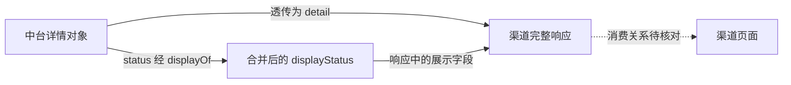

# 跨仓库契约图与业务语义层：公开方案借鉴（2026-10-31）

## 判断

有值得借鉴的机制，优先级是契约与返回字段流、可追溯的关系查询、业务术语到实现入口的链接。当前项目可先验证一个窄范围契约索引，不需要马上建设全量业务图或更换图数据库。

业务能力适合作为检索入口；函数、接口、字段、条件和原文仍是证据单元。向量／BM25 可找到入口，结构边用于跨文件与服务扩展，业务补充知识解释源码难以确认的语义。几种机制协作，不能推导为向量几乎必然无效、行业只有图这一条路。

这是一份建议与来源核查，未修改生产检索方案、生成 AST、构建新索引或新增业务问答模型调用。现有工程资料边界、显式准备结构资料和 ProjectContext 隔离约定继续有效。

## 来源核查与适用范围

| 原始来源 | 已确认的机制／数据 | 本项目应如何解释 |
| --- | --- | --- |
| [Ariadne README](https://github.com/whyy9527/ariadne)、[Benchmark](https://github.com/whyy9527/ariadne/blob/main/BENCHMARKS.md) | 契约层发现；SQLite 与 TF-IDF。48 条人工复核查询 Top-1 89.6%、MRR 0.927；文档明确操作名较多，为开发回归，非保留的自然语言相关性基准 | 借鉴端点／事件锚点和有边界的链路返回，不能把该指标当自然语言业务问答正确率 |
| [Springgraph 评测](https://github.com/jinglonglong/springgraph/blob/master/docs/evaluation.md) | 框架专属解析；作者报告七仓库中位数 token、耗时、工具调用下降 57%、46%、71%；强调结构追踪任务，Read 实测 0–2 而非保证为零 | 借鉴 Spring 适配器和专用查询工具。作者小样本实验未在本机复现，不承诺同等收益 |
| [Code-Graph-RAG 多工程文档](https://docs.code-graph-rag.com/guide/multi-project/) | 路由模板、网络调用和跨仓库解析边；记录未解析依赖；文档说明匹配以 URL 路径为主，部分动态 URL 不连接 | 借鉴类型化连接与显式未解析项；目标服务和配置也应核对，不能仅以同路径证明属于本题服务 |
| [Delivery Hero Company Brain](https://deliveryhero.jobs/blog/building-the-company-brain-scaling-code-context-with-knowledge-graphs/) | 结构遍历和专用工具，与关键词／语义搜索并存。约 40 万节点、110 万边、35 仓库；78% 时间与 82% 成本降幅是作者代表性工作负载报告 | 借鉴定向查询、最小相关节点和增量更新，不把图规模或该百分比作为本项目验收目标 |
| [LogicLens 原论文](https://arxiv.org/html/2601.10773v1) | 结构节点、领域实体和 LLM 语义富化；ReAct Agent 自选工具；30 个代表问题的人评 | 借鉴领域实体／操作链接与源码工具；不能认定图自动保证调查完成或消除答案矛盾。生成的语义需要依据与复核 |
| [Boldare 原文](https://www.boldare.com/blog/using-rag-for-domain-knowledge-in-microservices/) | 显式领域与事件知识；Qdrant、向量＋BM25 和本地重排；作者明确仍在测试阶段 | 支持精简业务补充知识的方向，不支持“都已放弃向量、统一改图”的概括。RAG 检索和模型训练也不能混为一谈 |
| [SANER 2026 论文介绍](https://conf.researchr.org/details/saner-2026/saner-2026-industrial-track/3/From-Textual-Descriptions-to-Code-A-Filtering-Approach-for-Locating-Business-Rules) | 从规则文本结合 NLP 与代码分析过滤方法候选 | 借鉴业务词和代码特征共同缩小范围，不代表已证明跨系统连接 |
| [ACL 2026 遗留业务规则抽取论文](https://aclanthology.org/2026.acl-industry.4/) | 语法、控制／数据流形成中间表示，再由 LLM 生成有源码追溯的结构结果与字段映射；作者报告 93% 规则一致率、约 70% 文档工作量减少 | 借鉴“结构事实先行、语义生成受其约束”。指标属于该 COBOL／PL/I 工业任务，不能转换成 Java 问答正确率 |
| [Schema-Free Text-to-SQL](https://arxiv.org/abs/2610.33946) | 从查询日志抽取关系，借领域实体匹配桥接业务词与标识符 | 可借鉴实体链接机制；数据库任务结果不是代码问答的直接验证 |

starchainx 本次未定位到所指具体原始工程，不以该条能力描述作为实施依据。Traceable RAG 的原始 [COBOL-Comprehension 仓库](https://github.com/DIAG-Sapienza-BPM-Smart-Spaces/COBOL-Comprehension) 已定位；上述 93%／70% 数字对应 ACL 业务规则抽取论文，不把不同项目的数据混用。各来源仅核查公开说明和方法，未自行复现其性能。

## 当前项目可复用的基础与缺口

- `knowledge/edges.py` 已有 IntegrationEdgeResolver，读取 HTTP_ENDPOINT／HTTP_CALL／RPC_CALL 等事实，连接 HTTP 与 Feign，并存证据 ID。并非从零开始。
- 当前 HTTP 匹配主要比较方法与路径；Feign 另核对服务标识。唯一匹配被标为 VERIFIED 是当前解析器的规则状态，不能直接当成运行时真实执行或业务正确性证明。
- `codeintel/analysis.py` 有 Spring 注解与 Feign 提取；当前未见 Java RestClient 流式调用的完整契约／返回字段绑定。新模块需要补真实使用的语法，不能只挂一个图数据库。
- LangChain 主问答目前只有文件工具、可选 Investigation 与 SearchCode，没有契约链或字段流查询工具；现有候选关系尚未成为这条主链的检索能力。
- 业务补充知识、工程职责导航、索引和评测框架已存在，可继续复用。资料来源和适用范围不能因放进同一张图而被抹平。

## 本题最需要的是返回字段流

普通调用图能告诉 Agent 去读渠道与中台，但不自动证明字段保留还是被删除。对“渠道处理中”题，要同时保存：

中台详情含 payments[].status 和 booking.status；渠道把完整对象放入 detail，同时另算展示字段。只有展示映射合并，不能据此断定整个响应丢了字段。页面消费仍未确认。

索引需要字段生产、对象透传、字段投影／转换等关系及其条件，不能只有 CALLS。字段只被改名、嵌套或另算展示值时应分别表示；不支持解析的动态逻辑保留未解析，不补成确定事实。模型仍负责解释业务条件，结论生成不能重新发明与已确认字段事实相反的总断言。

## 建议的窄范围实现

第一阶段先覆盖实际 Spring Controller、RestClient 及其配置、Map／DTO 返回对象、异步回调和定时补偿入口；Feign 按已有解析的缺口补。Kafka、GraphQL、Mapper／SQL 依目标工程和题型逐步扩展，不为凑技术栈先全量支持。

物理存储先复用工程内 SQLite。核心记录是对象、契约、关系与原文证据；每条边保存两端身份、连接依据、源码位置、索引版本及确认状态。HTTP 连接核对目标服务、方法和路由模板；事件连接核对主题、配置和生产／消费端。静态候选链不等于某次请求真实走过该链。

同一 ProjectContext 内多仓库可以连接，不同平台工程不因相同仓库 ID、路由或 topic 自动合并。结构资料通过显式准备／更新生成，问答不隐式解析 AST。源码变化后保留失效与重读提示；沿用 Git diff 增量更新思路。

检索过程建议为：

1. 用业务术语、实体／动作、BM25 和向量找少量入口候选。
2. 由程序沿明确的契约和字段关系扩展，控制方向、深度与原文预算。
3. 将未解析的连接转为补查任务，直接关联到当前入口与证据，不等待模型自觉更新独立计划。
4. 返回小型证据包：已确认路径、字段来源、转换条件、对应源码及仍未确认项。
5. 收尾按接口数据、展示映射、页面消费分别作答，核对断言所指对象及其证据范围。

可提供少量工具，例如 FindCapability、TraceContract、TraceResponseFields、GetEvidence；工具名称和 schema 待实现时确定。图负责定位和组织关系，源码片段负责实现证据；Agent 仍可用 Read／Grep 补查索引没有表达的内容。

业务语义层先复用现有短文档，登记术语、边界和隐式关系，链接到契约入口。例如“提款”“外部付款”“中台入账”应区分，不因词近就合并为一个成功状态。LLM 可提议能力节点和关联，但先作为待核对候选，不把未经确认的流程摘要放成长期事实，也不手抄完整代码流程。

## 验证顺序

保留当前错误题为已知回归，另外准备契约同名、HTTP 透传、回调／补偿与业务术语分离的独立题，标注关系两端、连接和字段来源，安排独立复核。生成索引与检索表达不得读取参考答案。

先比关系解析的漏边／错边及未解析状态，再比相同原文预算下的路径与字段证据覆盖；最后做同模型同预算的 Agent 问答。设置正常文件工具、增加契约索引、契约索引加业务语义三组，保留正常 README／需求等资料。语义增益与代码结构增益分别解释。

验收重点是有没有补齐正确连接、有没有错误地连到别的服务、能否确认返回字段、答案是否仍自相矛盾，以及达到同等质量的 token／耗时。少 Read、图节点多或作者项目的百分比均不能代替答案验收。首先验证一个窄范围中间层有用，再决定是否扩大语义图与框架支持；本记录不代表已批准切换生产方向。
