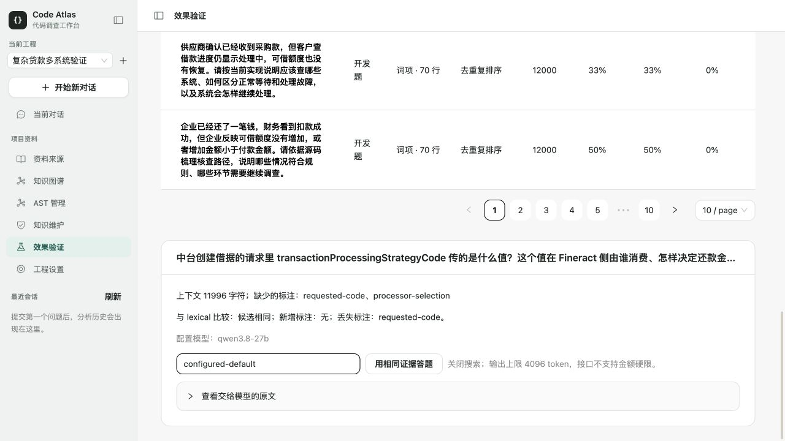

# 同候选的上下文选择对照

日期：2026-10-30。

## 已完成的实现

检索诊断新增复用已保存候选的能力，以及原顺序、去重复排序、候选内段落选择三种组装策略。页面、CLI 和工程内 API 均可发起本地对照。默认保留原顺序，主问答调查未改动。

每条结果分别记录检索策略、组装策略和版本、候选来源、组装耗时，以及同题同预算下新增和丢失的标注组。原候选的顺序、分数、位置、正文必须与冻结输入一致，原上下文结果不覆盖；选入原文逐行检查属于候选范围。复用候选只记录读取成本，原检索时间仍来自来源策略，不能宣称为新检索速度。

本轮没有生成 AST，没有运行真实模型请求，也没有增加声称来自生产的新问题或业务事实。三道开发案例的已有引文已重新核对冻结原文，标注仍是助手核对、待人工复核，没有改成业务人工验收状态。

## 实验输入与对照

批次：`validation-projects/complex-loan/.data/evaluations/retrieval/retrieval-20261030-requirements-restored/`。它已包含三份正常需求资料，共 8,096 个文件。策略只复用其中 `lexical` 已保存的 40 个候选；使用原 12 道开发题、相同问题和 12,000 字符预算。没有用原保留题选择参数或运行新策略。

先增加原顺序的复用对照 `lexical_ranked_replay_v1`：12 题的候选和最终原文均与原结果逐一相同。所有实验的候选标注覆盖仍为 72.2%。

| 策略 | 上下文标注覆盖 | 改善题数 | 退化题数 | 新增标注组 | 丢失标注组 |
| --- | ---: | ---: | ---: | ---: | ---: |
| 原顺序／原顺序复用对照 | 34.7% | — | — | — | — |
| 去重复排序 v1 | 30.6% | 0 | 1 | 0 | 1 |
| 候选内段落选择 v2 | 22.2% | 2 | 5 | 2 | 6 |

段落选择第一版遗漏了部分分隔空行，完整引文覆盖受影响，单独保存为 `lexical_focused_v1`，覆盖 15.3%；保留空行后的版本保存为 `lexical_focused_v2`，覆盖 22.2%。两版原始输出保留。所有试跑选入片段的实际正文与行号范围检查通过；空行差异对严格引文指标的影响不能解释成答案质量提升。

本次观测到的 12 题合计组装时间：原顺序原记录约 0.022 秒、原顺序复用约 0.044 秒、去重复排序约 0.232 秒、段落选择 v2 约 2.931 秒。它们是单次本机观测，原顺序复用包含后来新增的原文位置检查，早期记录未包含；未做重复性能测量，不用于宣称稳定的速度比例。

## 三道开发题的结果

| 题目 | 原顺序 | 去重复排序 | 段落选择 v2 | 解释 |
| --- | ---: | ---: | ---: | --- |
| 重复成功回调 | 50% | 50% | 0% | 去重复排序仍未交付补偿入口与额度流水；段落选择额外丢失付款防重及入账结果的完整标注 |
| 渠道显示处理中 | 33.3% | 33.3% | 0% | 渠道查询实现本就未完整进入候选；段落选择又丢失已覆盖的状态语义证明 |
| 已还款但额度未恢复 | 50% | 50% | 50% | 从 Fineract 分配到额度恢复的必要连接依据未完整召回，组装策略不能从候选外取得原文 |

段落选择在旧结果处理和报价有效期两题各新增一组标注，但同时让其他五题退化。去重复排序在策略码题中丢失中台实际传值。不能只报告局部变好或忽略退化；当前没有证据支持将这两项策略设为默认。

这些是必要标注覆盖，既不是材料充分率，也不是答题正确率，更不等于生产 Agent 的完整效果。当前标注仍可能遗漏等价路径或采用过宽引文，后续需要人工复核。

## 接下来的实验

本轮已把同候选、同预算的选择问题从召回中拆开，但没有修复重复回调题的关键遗漏。接下来优先比较保持方法、条件与结果完整的检索单元，再单独接入引用和调用导航。结构资料必须由用户显式准备或更新、按版本使用，不能在检索或评测时隐式生成 AST。

对“渠道处理中”“已还款但额度未恢复”先补候选缺口，再评价组装。真实业务语义和新保留题仍需从真实使用资料中收集；当前不补写假定规则，不把示例题改名为生产反馈。固定证据的模型对照和正式 Agent 验收尚未执行。

## 检查与页面验收

后端相关单元与 API 回归共 47 项通过，覆盖候选复用不重跑全语料召回、冻结原文一致、源结果不覆盖、空行与行号、预算、同覆盖下的证据交换、管理员认证和跨工程请求隔离。前端 11 项测试通过，构建通过；保留已有的产物体积提示。

真实浏览器中点击“复用候选对照”完成一次本地运行，确认表格显示选择方式与覆盖变化，打开策略码题后显示候选相同、丢失 `requested-code`。没有点击答题按钮。该页面运行作为独立策略保存，不覆盖命令行试跑。

后续方法单元、整段保留及候选原文预算配平的实现与结果见[2026-10-31 方法单元对照](retrieval-method-units-20261031.md)。它有局部改善，仍保留关键退化，未替换生产默认策略。
