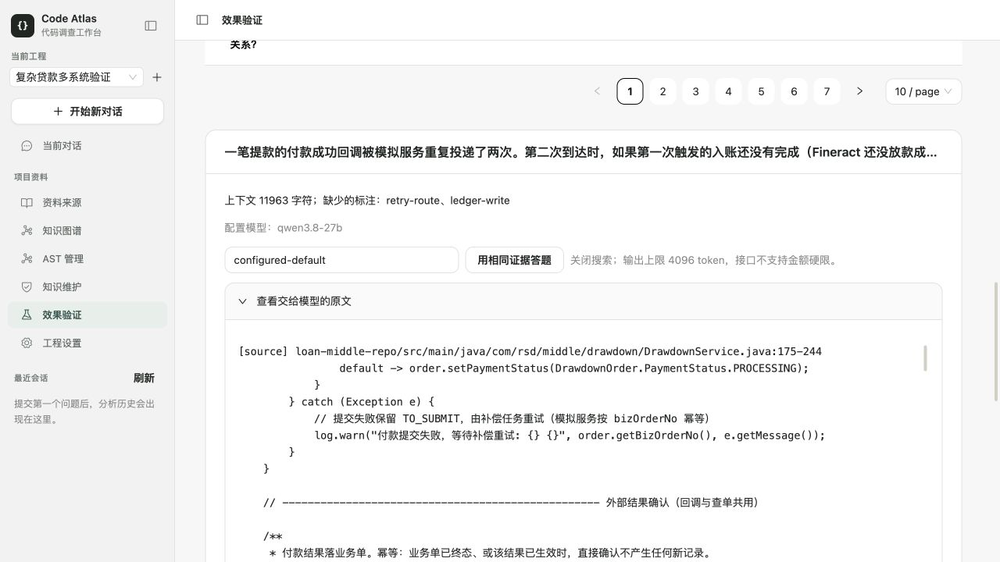

# 首轮检索诊断与实现记录

日期：2026-10-29。

2026-10-30 复核发现首轮兼容单工程的冻结语料遗漏了已配置的需求目录；首轮数值保留作历史记录，不能作为资料范围与生产问答一致的基线。修复、新批次和原因分析见本文末节。

## 实现范围

已完成方案第一阶段的独立检索基准、证据标注格式、冻结资料、逐题候选与上下文覆盖计量、其他检索器的位置结果导入、固定证据答题、工程内 API 和页面入口。规范见[检索诊断约定](../../spec/retrieval-evaluation.md)。

页面入口为“效果验证 → 检索诊断”，可查看批次、策略、开发题／保留题、字符预算、缺失证据及实际交给模型的原文。导入和启动使用项目管理员认证；结果读取和运行按当前工程路由。没有改变生产 Agent 默认资料模式，也没有生成 AST。

固定证据实验既可使用关闭工具的 Claude CLI，也可读取 `.env` 中启用的 OpenAI 兼容接口。后者仅发送固定规则和所选问题／原文，没有搜索、会话历史或评分标准。生产主问答仍使用 Claude CLI。

## 数据与标注

- 工程：`complex-loan-validation`。
- 标注：现有 20 道已知回归题，共 53 个必要证据组，12 道开发题、8 道保留题。
- 来源：既有贷款验证题库，不能称为真实生产用户反馈。
- 标注由助手核对当前原文整理，状态为草稿，尚未人工复核；允许等价证明路径，关系项同时检查标注的端点与连接依据。
- 冻结资料包含 8,093 个文件，约 57.7 MiB。当前批次使用证据修订 v2；早期 v1 的担保覆盖层引文范围已修订，旧批次保留，旧标注版本标为已被替代。

当前冻结目录：

```text
validation-projects/complex-loan/.data/evaluations/retrieval/retrieval-20261029-121448-970959/
```

标注文件：`validation-projects/complex-loan/evaluations/retrieval-evidence-v2.json`。它不复制旧题库的参考答案或评分标准。批次中标注保存在协议内，检索器只使用问题与冻结原文。

## 首轮观测

默认候选 40 项；字符预算包括位置头与原文，按完整行组装并去除重复行。`lexical` 是 BM25 词项基线，源码窗口最多 70 行；`lexical_compact` 只把窗口改为最多 30 行。

| 策略 | 集合 | 字符预算 | 题数 | 候选证据覆盖 | 上下文证据覆盖 |
| --- | --- | ---: | ---: | ---: | ---: |
| lexical | 开发题 | 4,000 | 12 | 75.0% | 22.2% |
| lexical | 开发题 | 12,000 | 12 | 75.0% | 37.5% |
| lexical | 保留题 | 4,000 | 8 | 78.1% | 0.0% |
| lexical | 保留题 | 12,000 | 8 | 78.1% | 11.5% |
| lexical_compact | 开发题 | 4,000 | 12 | 49.3% | 16.7% |
| lexical_compact | 开发题 | 12,000 | 12 | 49.3% | 27.8% |

这些数值是每题标注覆盖的平均值，不是答案正确率，也不是对现有生产 Agent 全部调查能力的评分。两种窗口下都没有题目覆盖全部已标注证据；严格的跨段原文范围会影响这项指标，需要结合标注复核解释。

可以确认：本基线同时存在候选遗漏，以及进入候选后仍未进入最终上下文的标注。例如重复付款回调题的候选覆盖为 100%，但 12,000 字符上下文覆盖仅 50%。简单缩短窗口在开发题上没有改善，未继续用保留题挑选参数，未把它设为生产默认。

尚不能确认：该现象能否解释实际产品中的全部错误、强模型是否掩盖设计不足、语义搜索或结构展开能带来多少收益。下一步应先复核关键标注范围，再针对条件、调用衔接与上下文组织设计一个改动进行同题比较。

## 模型配置与一次真实调用

用户先要求核对模型，随后修改项目 `.env`。核查发现此前 `BUSINESS_CODE_MODEL_*` 没有被当前 Claude CLI 主链路消费，因此仅修改这组值不会切换主问答模型。本轮为固定证据实验增加了兼容接口适配，并让脚本复用项目 env 加载器。

当前配置为阿里云兼容接口、模型 `qwen3.8-27b`、温度 0.5、读取超时 120 秒。只读查询 `/models` 时，接口模型列表包含该编号。认证值未写入报告、命令记录或前端响应。

在用户明确批准后，只执行了一次 Qwen 固定证据请求：

- 案例：`v2-channel-display`，渠道显示“处理中”的区别与字段。
- 原文：与本批次 `lexical`、12,000 字符预算的上下文完全相同，实际为 11,956 字符。
- 请求模型与本地解析模型均为 `qwen3.8-27b`，最大输出 4,096 token。兼容接口没有美元金额硬限。
- 请求在约 120.142 秒读取超时；未获得模型回答、用量或实际报告模型名称，没有追加重试。

所以当前只确认配置和模型列表可用，尚未完成真实问答验证，不能评价该模型的回答质量。失败记录独立保留，没有计为零分。更早的 CLI 认证与网络失败也保留，不能与 Qwen 正确率混算。

## 检查结果

后端 65 项相关回归通过，包括证据与预算边界、冻结资料复用、跨工程相同案例／仓库编号隔离、管理员认证、固定证据不泄漏评分内容、模型和实际用量记录、兼容接口传输，以及现有问答评测和工作区兼容性。

前端 11 项测试通过，构建通过。使用真实浏览器检查了检索诊断入口、逐题结果、策略区分、缺失标注、冻结原文，以及页面显示 `qwen3.8-27b` 和实际 token 限制。构建保留现有的产物体积提示。

页面核查截图：



## 2026-10-30：资料范围修正与三类原因复核

### 修正与重跑

`WorkspaceManager.requirements_root` 原先只保存构造参数中的显式覆盖值，配置中的需求目录在挂载工作区时才解析。检索诊断直接读取这个属性，导致兼容单工程的需求目录被遗漏；正式问答的工作区挂载不受此遗漏影响。现将需求目录统一在管理器初始化时解析，工作区、资料就绪信息和检索诊断共用该结果。注册工程继续使用 `ProjectContext` 中本工程已管理的资料，不读取未显式导入的配置资料。

新批次：`validation-projects/complex-loan/.data/evaluations/retrieval/retrieval-20261030-requirements-restored/`。沿用证据 v2、20 道题、40 个候选、70 行窗口和原预算，不调整排序参数，不调用模型，不生成 AST。新增 `产品规则.md`、`接口与状态约定.md`、`系统职责.md` 三份需求资料，共 8,096 个文件；旧批次的 8,093 个文件与新批次对应原文逐一相同，未移除文件。

| 集合 | 字符预算 | 题数 | 候选证据覆盖 | 上下文证据覆盖 |
| --- | ---: | ---: | ---: | ---: |
| 开发题 | 4,000 | 12 | 72.2% | 19.4% |
| 开发题 | 12,000 | 12 | 72.2% | 34.7% |
| 原保留题 | 4,000 | 8 | 70.8% | 0.0% |
| 原保留题 | 12,000 | 8 | 70.8% | 11.5% |

这是资料范围纠错后的复算，不是新的独立保留题验收。增加需求资料改变了词项排序，部分已标注覆盖反而降低；标注尚未列尽需求文档的等价语义证明路径，因此不能从这些数值认定需求资料降低了答案质量。

重复付款回调题仍为候选覆盖 100%、最终上下文覆盖 50%，缺少补偿入口与额度流水证据。当前标注每题选择一种证明路径、去除重复行并计入位置头，所需原文约 1,846—5,700 字符，均能放入 12,000 字符预算。这只检查标注原文的可容纳性，不证明标注已经完整，也不代表系统已经能自动选出这些原文。

本次检索、工作区及运行时相关 30 项测试通过；新增测试覆盖兼容工程的配置需求目录进入冻结语料，以及注册工程只使用本工程管理的需求资料。

### 对题目、资料与检索架构的判断

1. **题库覆盖面偏窄，不能统一称为题目太简单。** 20 题中仍有异步回调、状态边界与跨系统追踪。其标注只涉及 14 个源码文件和 2 个业务补充文件；12 题涉及 `LimitService`，8 题涉及 `DrawdownService`，只有 1 题的标注深入 Fineract 仓库。开发题与原保留题还存在报价版本、降额等同规则变体。仓库文件总量不能代表问题的实际调查深度；当前题库更适合已知场景回归，尚不足以代表复杂真实业务调查。

2. **业务资料的独立语义增量不足，比资料数量少更有依据。** 53 组标注中只有 3 组属于业务语义，且全部允许源码证明路径；当前标注没有一道必须依赖补充资料的题。五份补充文件主要整理状态、额度、职责和术语，这些信息在正常需求或源码中已有大量等价表述。不能据此宣称真实业务资料已充分，也不能靠复制完整调用链来补足。应从真实问题中确认源码、README 和正常需求仍无法消歧的业务叫法、跨系统约定与例外，经业务确认后补入，并与源码关联核查。

3. **Agent 自主调查的方向可保留，可用检索能力和证据组织仍需补全。** 生产运行时默认只提供 `Read / Glob / Grep`，现有符号与调用导航尚未作为专用工具接入；关系主要由模型搜索后拼接。独立基准则使用词项排名、固定行窗口和按序装入预算，未按条件、动作、结果与调用衔接选择互补材料。候选到上下文的损失已在基准中出现，但不能直接推定生产 Agent 有相同比例的损失。优先针对实际错题检验符号级片段、必要端点展开和上下文组织，再依据同题收益决定语义召回等投入。

三项可能同时影响结果。另需区分模型拿到材料后的使用错误和评价标准错误；已批准的单次 Qwen 请求超时，当前没有成功的固定证据模型对照，仍不能确认“强模型掩盖设计不足”或给各原因分配占比。下一轮应先复核少量真实错题的必要原文和标注，分别检查资料是否存在、检索是否交付、模型能否正确使用，再决定改动；保持正常资料完整，不为制造差异削减对照资料。

随后完成的同候选上下文选择试验见[2026-10-30 对照记录](retrieval-context-selection-20261030.md)：新策略均未改善总体覆盖，保留原默认策略与全部试跑结果。
