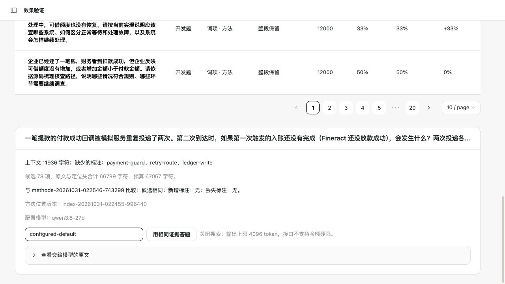

# 方法单元与候选原文预算对照

日期：2026-10-31。

## 本轮实现与资料边界

已实现复用已有代码索引的方法位置、方法单元检索、整段保留，以及按旧候选原文规模配平的对照。CLI、工程内 API 和“效果验证 → 检索诊断”均可操作；生产问答默认策略保持不变。

当前工程没有已保存的 AST 文件。本轮没有创建 AST、调用解析器、重新索引源码或运行真实模型请求。现有代码索引通过只读连接读取；显式操作将核对后的定位资料保存为批次内独立版本，后续评测只读取这个版本和冻结原文。源码、需求、业务补充资料均沿用原批次，没有添加参考答案或新业务事实。

初次保存的方法位置版本为 `index-20261031-020342-520749`，属于批次 `retrieval-20261030-requirements-restored`，共 4,941 个 Java 文件、31,430 个方法位置；16 条未通过本轮定位核对的记录单独保留。核对包括工程仓库目录、修改时间、当前文件与冻结原文一致、声明与结束位置匹配。索引读取与位置核对耗时约 6.95 秒，不含加载已有冻结语料和写出定位文件，单列于答题与检索时间之外。这些是机械定位核对，不代表编译器确认或业务链路完整。

方法之外的字段、配置、其他语言，以及未通过核对的定位，仍保留正常文本检索能力。源码范围仍为原 8,096 个文件；结构资料只改变片段组织，不删减对照资料。方法说明与分隔空行保留，避免用省略空行影响完整引文指标。

## 对照方式

只使用原 12 道开发题、相同冻结原文和 12,000 字符最终上下文预算，不用原保留题选择参数。分开比较：

1. 原 70 行窗口与原顺序组装。
2. 方法单元与原顺序组装，只改检索单元。
3. 复用第 2 项的同一批方法候选，改为整段保留；装不下时尝试后续单元，不截断候选前缀。

固定 40 项时，旧候选正文平均约 65,240 字符，方法候选正文约 31,660 字符。相同条数并不等于相同原文规模，因而补做逐题按旧候选原文预算匹配的对照：旧候选正文与定位头按片段累加平均约 68,041 字符，新候选的完整排名前缀平均约 66,471 字符，实际 44—102 项，低于 500 项数量边界；最终上下文预算仍为 12,000 字符。

匹配预算只读取旧候选大小，不读取必要证据标注。该指标包含重复片段、是字符数而非模型 token，不表示两种检索器有相同计算成本或相同有效信息量。

## 开发题结果

以下为逐题覆盖的宏平均；改善与退化均相对原窗口策略：

| 策略 | 候选标注覆盖 | 上下文标注覆盖 | 改善 | 退化 | 持平 |
| --- | ---: | ---: | ---: | ---: | ---: |
| 70 行窗口＋原顺序，40 项 | 72.2% | 34.7% | — | — | — |
| 方法单元＋原顺序，40 项 | 54.9% | 39.6% | 3 | 2 | 7 |
| 方法单元＋整段保留，40 项 | 54.9% | 42.4% | 4 | 2 | 6 |
| 方法单元＋原顺序，原文预算匹配 | 61.1% | 39.6% | 3 | 2 | 7 |
| 方法单元＋整段保留，原文预算匹配 | 61.1% | 45.1% | 4 | 1 | 7 |

最后一项新增 4 个已标注证据组、丢失 1 个，改善来自降额边界、生效规则、旧结果处理与多层额度计算等题。它没有修复所有关键场景，也没有证明答案质量改善。

固定 40 项和匹配原文预算分别记录，不能把候选覆盖下降全部解释成方法定位质量下降，也不能只用上文 45.1% 的平均值宣称方案已通过。数据只来自已知回归开发题，标注仍待人工复核，未完成新保留题、固定证据答题或生产 Agent 验收。

## 关键场景仍有缺口

| 题目 | 原窗口上下文覆盖 | 方法＋整段保留、预算匹配 | 本轮观测 |
| --- | ---: | ---: | --- |
| 重复成功回调 | 50% | 25% | 候选已覆盖全部标注，但付款防重、补偿入口和额度流水未交付完整；原方法仍更好 |
| 渠道显示处理中 | 33.3% | 33.3% | 方法候选覆盖仅 33.3%，渠道查询与中台返回字段仍缺，需要先处理入口与候选问题 |
| 已还款但额度未恢复 | 50% | 50% | 还款分配到额度恢复的连接依据仍未完整进入候选 |

重复回调题的新候选为 78 项，原文与定位头共 66,799 字符，不超过旧候选的 67,057 字符预算；最终上下文约 11,936 字符。候选已经找齐而上下文仍缺，说明保留完整方法并没有自动解决互补证据选择。下一轮需分别验证调用导航与按问题缺口选择证据，不把问题全归于候选条数。

## 复现与保存结果

结果均保存在原冻结批次的独立策略目录中：

- `lexical_methods_ranked_v1`、`lexical_methods_whole_v1`：固定 40 项、先改单元再改组装。
- `methods_ranked_vs_windows_v1`、`methods_whole_vs_windows_v1`：复用相同候选，为原窗口增加逐题配对记录，原输出保留。
- `methods_matched_ranked_v1`、`methods_matched_whole_v1`：原文预算匹配；候选实际数量与大小逐题保存。

每条结果记录检索单元、方法位置版本、候选数量与字符预算、组装策略与版本、候选和上下文覆盖、新增与丢失的标注，以及候选是否变化。这里的计数、定位数量或读取次数均不作为业务图谱收益。

## 检查与页面验收

后端相关测试共 56 项通过，包含已有索引只读复用、无版本时不隐式解析、冻结位置复用、字段与配置回退、空行和原文范围、整段预算、按旧候选大小匹配、跨工程／批次版本拒绝，以及管理员认证和 API 兼容性。前端 11 项测试通过，构建通过，保留现有产物体积提示。

真实浏览器中依次点击“保存已有方法位置”“对照方法单元”，再选择“整段保留”并“复用候选对照”。确认新位置版本、候选预算匹配、候选来源切换、候选相同的组装对照，以及关键题缺失标注均可见。验收服务使用数据库的只读副本准备临时实例，未修改原库；验收结束停止实例并清理副本。未点击模型答题按钮。

